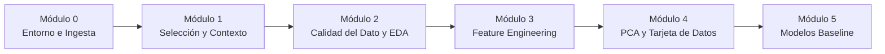

<div align="center">

# 📱 Impacto de las Redes Sociales en el Bienestar y Rendimiento Estudiantil

**Proceso KDD (Hito 2): Selección, Integración Open Data, Preproceso, EDA y Tarjeta de Datos**

[](https://www.python.org/)
[](https://jupyter.org/)
[](https://scikit-learn.org/)
[](https://pandas.pydata.org/)
[](#)

*Asignatura: Minería de Datos · Grado en Ingeniería Informática (4.º curso · UCLM)*

</div>

---

## 🎯 Descripción del Proyecto

Este repositorio contiene el desarrollo técnico y documental consolidado del **Hito 2** del proceso **KDD** (*Knowledge Discovery in Databases*), centrado en analizar cómo los hábitos de uso de redes sociales afectan al **estrés percibido**, la **salud mental** y el **rendimiento académico (GPA)** en población estudiantil.

> **Hipótesis Principal ($H_1$):** El deterioro psicométrico y académico no crece de forma lineal con las horas de pantalla, sino que presenta un **punto de inflexión** ($> 3.5\text{ h/día}$) amplificado por el **uso nocturno** (`Late_Night_Usage`) y la **comparación social**.

---

## 🗺️ Arquitectura del Pipeline KDD



| Módulo | Fase KDD | Responsable | Descripción clave y resultados verificados |
| :---: | :--- | :--- | :--- |
| **0** | **Configuración e Ingesta** | Equipo / M1 | Carga y auditoría por SHA-1 del espejo público fijado ($N = 4.500$, $d = 16$) mediante `src/fuente_auditoria.py`, sin fallback sintético. |
| **1** | **Selección e Integración Open Data** | Abdelmouiz kobry | Eliminación de `Student_ID`, normalización de categorías (`src/seleccion_normalizacion.py`) y `LEFT JOIN` descriptivos INE/SIIU/ESTUDES en una vista de contexto separada (`src/integracion_contextual.py`), excluida del entrenamiento. |
| **2** | **Calidad del Dato y EDA** | Ernesto | Auditoría de completitud (131 registros con nulos: 85 en GPA y 46 en PSS; 0 duplicados), regla física $\text{Uso} + \text{Sueño} \le 24\text{h}$ (máx. 19,5h), anomalías **IQR + LOF** (88/4.369 marcados) y `Figura_1_EDA_H1.png` (300 DPI). |
| **3** | **Transformación y Feature Engineering** | Pablo | Creación de variables (`Weekly_Total_Hours`, `Weekend_Binge_Ratio`, `DSDI`, `CWU`), discretización clínica PSS de Cohen, One-Hot Encoding (14 columnas), split estratificado 70/30, imputación por mediana y doble escalado (Z-score / Min-Max) sobre Train (**29 predictores**). |
| **4** | **Reducción Dimensional y Tarjeta de Datos** | Yeni | Ranking *Random Forest* e *Información Mutua*, **PCA** (**14 componentes = 85,18% varianza**), 10-fold CV estratificada sin fuga (`F1-Macro: 0.8893 ± 0.0403`), `Figura_2_PCA_Ranking.png` y exportación de `tarjeta_datos_consolidada_H2.csv`. |
| **5** | **Verificación y Baselines** | Javier | Validación de `tarjeta_datos_consolidada_H2.csv`, semilla fija (`RANDOM_SEED = 42`) y baselines 10-fold CV con `Pipeline` sin fuga (**RF:** `0.8885`, **CART:** `0.8483`, **k-NN:** `0.6595`; **k-Means k=4 Silueta:** `0.2023`). |

---

## 📊 Fuentes de Datos

| Fuente | Tipo | Variables aportadas |
| :--- | :--- | :--- |
| **Impact of Social Media on Life** (espejo público fijado por SHA-1; referencia original Kaggle sin equivalencia bit a bit certificada) | Dataset base (`data/origen.csv`, descargable vía script) | Demografía, plataforma, horas de uso, sueño, comparación social, PSS, salud mental, GPA e impacto global. |
| **INE** *(Encuesta TIC Hogares 2025)* | Contexto descriptivo (`data/INE_TICH_2025_contexto.csv`) | `INE_Redes_Sociales_Participacion_Pct_2025` (no predictor) |
| **Ministerio de Ciencia / Universidades** *(SIIU 2024/25)* | Contexto descriptivo (`data/SIIU_2024_25_contexto.csv`) | `SIIU_Nota_Expediente_Grado_10_2024_25` (no predictor) |
| **Observatorio OEDA** *(Encuesta ESTUDES 2025)* | Contexto descriptivo (`data/ESTUDES_2025_contexto_edad_sexo.csv`) | `ESTUDES_RRSS_Uso_Problematico_Pct_2025` (no predictor) |

---

## 📁 Estructura Unificada del Repositorio

```text
.
├── src/
│   ├── fuente_auditoria.py                       # Descarga, hash SHA-1 y auditoría del CSV origen
│   ├── seleccion_normalizacion.py                # Selección de atributos y normalización sin fuga
│   ├── integracion_contextual.py                 # Cruces descriptivos LEFT JOIN (INE, SIIU, ESTUDES)
│   └── ejecutar_modulo1.py                       # Orquestación y evidencias del Módulo 1
├── data/
│   ├── INE_TICH_2025_contexto.csv                # Referencia contextual INE (2025)
│   ├── SIIU_2024_25_contexto.csv                 # Referencia contextual SIIU (2024/25)
│   └── ESTUDES_2025_contexto_edad_sexo.csv       # Referencia contextual OEDA-ESTUDES (2025)
├── tests/
│   ├── muestra_publica_17.csv                    # Fixture de prueba (17 registros)
│   ├── test_fuente.py                            # Pruebas de auditoría y esquema
│   ├── test_seleccion.py                         # Pruebas de selección y normalización
│   ├── test_integracion.py                       # Pruebas de LEFT JOIN contextual
│   └── test_ejecucion.py                         # Pruebas end-to-end del Módulo 1
├── Entrega_2_Pipeline_KDD_EDA_Preproceso.ipynb   # Notebook modular completo (Módulos 0 a 5)
├── Entrega_2_Informe_Estado_Practica_KDD.docx    # Informe técnico consolidado de estado KDD
├── tarjeta_datos_consolidada_H2.csv              # Vista minable final (4.500 × 32)
├── Figura_1_EDA_H1.png                           # Figura multipanel EDA y contraste H1 (300 DPI)
├── Figura_2_PCA_Ranking.png                      # Figura PCA (14 PCs) + rankings RF / MI (300 DPI)
├── TEAM_CHANGELOG.md                             # Registro de cambios y responsabilidades
├── requirements.txt                              # Dependencias del proyecto
├── .gitignore                                    # Archivos locales excluidos de Git
└── README.md                                     # Documentación principal del repositorio
```

---

## 🚀 Cómo Ejecutar el Proyecto

### 1. Requisitos previos

Asegúrate de tener **Python 3.10+** e instalar las dependencias desde `requirements.txt`:

```bash
pip install -r requirements.txt
```

*(Opcional: instala `statsmodels` si deseas curvas LOWESS en lugar de regresión polinómica de grado 2 en el Módulo 2).*

### 2. Ejecutar los tests unitarios

```bash
python -m unittest discover -s tests -v
```

### 3. Preparar datos (Módulo 1) y ejecutar el Notebook completo

```bash
python src/ejecutar_modulo1.py --descargar
jupyter notebook Entrega_2_Pipeline_KDD_EDA_Preproceso.ipynb
```

> **Reproducibilidad y procedencia:** El **Módulo 0** descarga en `data/origen.csv` (si falta) y valida el espejo público fijado en `src/fuente_auditoria.py` (esquema y Git Blob SHA-1 `0fa68d5f03c79c51eb817d67514980d04f0cd6be`). Si no puede validarlo, la ejecución se interrumpe: **no genera datos sintéticos**. No se ha demostrado identidad bit a bit con el archivo original de Kaggle. Las fuentes INE/SIIU/ESTUDES son solo contexto descriptivo y no atributos de predicción.

### 4. Artefactos generados

Al ejecutar el notebook completo se generan:
- `tarjeta_datos_consolidada_H2.csv` (**4.500 filas × 32 columnas**: 29 predictores, `Split` con 3.150 Train / 1.350 Test, `Target_GPA` con 85 nulos preservados y `Target_Overall_Impact`).
- `Figura_1_EDA_H1.png` y `Figura_2_PCA_Ranking.png` (figuras multipanel a 300 DPI).
- Salidas intermedias del Módulo 1 en `outputs/` (excluidas de Git).

---

<div align="center">
<sub>Proyecto académico de Minería de Datos · Hito 2 (Noviembre 2026)</sub>
</div>
