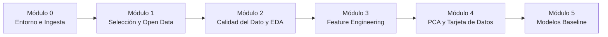

<div align="center">

# 📱 Impacto de las Redes Sociales en el Bienestar y Rendimiento Estudiantil

**Proceso KDD (Hito 2): Selección, Integración Open Data, Preproceso, EDA y Tarjeta de Datos**

[](https://www.python.org/)
[](https://jupyter.org/)
[](https://scikit-learn.org/)
[](https://pandas.pydata.org/)
[](#)

*Asignatura: Minería de Datos · Grado en Ingeniería Informática (4.º curso)*

</div>

---

## 🎯 Descripción del Proyecto

Este repositorio contiene el desarrollo técnico y documental del **Hito 2** del proceso **KDD** (*Knowledge Discovery in Databases*), centrado en analizar cómo los hábitos de uso de redes sociales afectan al **estrés percibido**, la **salud mental** y el **rendimiento académico (GPA)** en población estudiantil.

> **Hipótesis Principal ($H_1$):** El deterioro psicométrico y académico no crece de forma lineal con las horas de pantalla, sino que presenta un **punto de inflexión** ($> 3.5\text{ h/día}$) amplificado por el **uso nocturno** (`Late_Night_Usage`) y la **comparación social**.

---

## 🗺️ Arquitectura del Pipeline KDD



| Módulo | Fase KDD | Descripción clave |
| :---: | :--- | :--- |
| **0** | **Configuración e Ingesta** | Carga y auditoría del espejo público fijado ($N = 4.500$, $d = 16$), con rechazo de esquemas/archivos distintos y sin fallback sintético. |
| **1** | **Selección e Integración Open Data** | Eliminación de `Student_ID`, normalización de variables y `LEFT JOIN` descriptivos INE/SIIU/ESTUDES en una vista de contexto separada, excluida del entrenamiento. |
| **2** | **Calidad del Dato y EDA** | Auditoría de completitud y restricciones físicas ($\text{Uso} + \text{Sueño} \le 24\text{h}$), detección híbrida de anomalías (**IQR** + **LOF**) y visualización exploratoria para contrastar $H_1$. |
| **3** | **Transformación y Feature Engineering** | Creación de variables (`Weekly_Total_Hours`, `Weekend_Binge_Ratio`, `DSDI`, `CWU`), categorización de PSS y preparación de 29 predictores con imputación y escalado sobre Train. |
| **4** | **Reducción Dimensional y Tarjeta de Datos** | Selección de características (*Mutual Information* y *Random Forest*), análisis **PCA**, particionamiento estratificado (*Holdout* 70/30 + *10-fold CV*) y exportación de vistas minables. |
| **5** | **Líneas de Trabajo Baseline** | Prototipos iniciales de **Clasificación**, **Regresión con ablación**, **Clustering fenotípico** y **Perturbaciones contrafactuales**. |

---

## 📊 Fuentes de Datos

| Fuente | Tipo | Variables aportadas |
| :--- | :--- | :--- |
| **Impact of Social Media on Life** (espejo público fijado por hash; referencia original Kaggle sin identidad certificada) | Dataset base (espejo GitHub) | Demografía, plataforma, horas de uso, sueño, comparación social, PSS, salud mental, GPA e impacto global. |
| **INE** *(Encuesta TIC Hogares 2025)* | Contexto descriptivo | `INE_Redes_Sociales_Participacion_Pct_2025` (no predictor) |
| **Ministerio de Universidades** *(SIIU 2024/25)* | Contexto descriptivo | `SIIU_Nota_Expediente_Grado_10_2024_25` (no predictor) |
| **Observatorio OEDA** *(Encuesta ESTUDES 2025)* | Contexto descriptivo | `ESTUDES_RRSS_Uso_Problematico_Pct_2025` (no predictor) |

---

## 📁 Estructura del Repositorio

```text
.
├── Entrega_2_Pipeline_KDD_EDA_Preproceso.ipynb   # Notebook modular completo (Módulos 0 a 5)
├── Entrega_2_Informe_Estado_Practica_KDD.docx    # Informe técnico de estado de la práctica KDD
├── .gitignore                                    # Archivos locales excluidos del control de versiones
└── README.md                                     # Documentación principal del repositorio
```

---

## 🚀 Cómo Ejecutar el Proyecto

### 1. Requisitos previos

Asegúrate de tener **Python 3.10+** e instalar las dependencias principales:

```bash
pip install numpy pandas matplotlib seaborn scipy scikit-learn jupyter
```

### 2. Ejecutar el Notebook

```bash
jupyter notebook Entrega_2_Pipeline_KDD_EDA_Preproceso.ipynb
```

> **Reproducibilidad y procedencia:** El **Módulo 0** descarga (si falta) y valida el espejo público fijado en `modulo1_abdelmouiz_kobry/fuente_auditoria.py` (esquema y Git Blob SHA-1). Si no puede validarlo, la ejecución se interrumpe: **no genera datos sintéticos**. No se ha demostrado identidad bit a bit con el archivo original de Kaggle. Las fuentes INE/SIIU/ESTUDES son solo contexto descriptivo y no atributos de predicción.

### 3. Artefactos generados

Al ejecutar el notebook completo se genera `tarjeta_datos_consolidada_H2.csv` con **4.500 filas y 32 columnas** (29 predictores, `Split` y dos objetivos). El archivo incluye 3.150 registros Train y 1.350 Test; conserva 85 GPA desconocidos. También se generan los resultados temporales de Módulo 1 en `modulo1_abdelmouiz_kobry/outputs/`, excluidos de Git.

---

<div align="center">
<sub>Proyecto académico de Minería de Datos · Hito 2 (Noviembre 2026)</sub>
</div>


## Módulo 1: selección e integración de datos

La aportación de Abdelmouiz kobry se encuentra en [`modulo1_abdelmouiz_kobry/`](modulo1_abdelmouiz_kobry/README_MODULO1.md). Incluye auditoría del CSV, selección y normalización, y comparación contextual con tres fuentes españolas. Las estadísticas agregadas NO se usan como predictores. El notebook compartido ahora carga y valida la copia pública fijada y ejecuta el pipeline completo sin crear registros artificiales. Falta comprobar de forma independiente la identidad del espejo con la revisión original de Kaggle.
